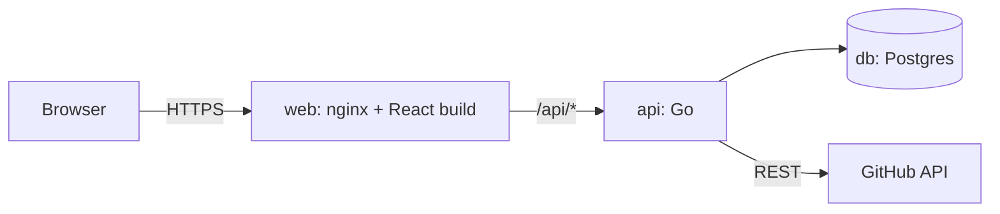

# Architecture

A web Kanban board for GitHub repositories. Users sign in to the app, link their GitHub account, and add a repository by its URL. Every task on the board is a GitHub issue. Its column and order on the board are stored in our database.

This document covers three parts only: the frontend, the API and the database. Agents and triggers are out of scope.

## Overview



| Service | Role |
| --- | --- |
| `web` | Serves the built React app and proxies `/api/*` to `api`, so the browser sees one origin. |
| `api` | Owns all business rules: accounts, GitHub links, projects, the board, sync with GitHub, settings. |
| `db` | Postgres. Stores users, sessions, GitHub links, projects, board layout, tasks and provider settings. |

The frontend never calls GitHub directly. Every GitHub call goes through the API, which holds the user's GitHub credential.

## Repository layout

```
/
├── docker-compose.yml
├── .env.example
└── src/
    ├── front/           React + TypeScript (Vite)
    │   └── Dockerfile   build with Node, serve with nginx
    └── back/
        └── api/         Go module
            ├── Dockerfile   multi-stage build to a small runtime image
            ├── cmd/api/     main
            ├── internal/    app, accounts, github, board, projects, settings, store, httpx, secret, apptest
            └── migrations/  SQL, embedded in the binary
```

## Docker Compose

One `docker compose up --build` builds and starts every layer.

- **db** runs `postgres:18` with a named volume and a health check.
- **api** builds from `src/back/api/Dockerfile`, waits for a healthy `db`, and runs migrations on startup before serving.
- **web** builds from `src/front/Dockerfile` and publishes the only exposed port.

Configuration comes from `.env`, documented in `.env.example`:

| Variable | Purpose |
| --- | --- |
| `PUBLIC_URL` | Base URL users open, used for the GitHub link callback. |
| `DATABASE_URL` | Postgres connection string for `api`. |
| `GITHUB_CLIENT_ID`, `GITHUB_CLIENT_SECRET` | The GitHub OAuth App used to link accounts. |
| `ENCRYPTION_KEY` | 32-byte key that encrypts stored GitHub credentials and provider keys. |

## Frontend

React with TypeScript, built by Vite.

- **Routing** with React Router.
- **Server state** with TanStack Query. The API is the only source of data, and there is no global client store.
- **Drag and drop** with dnd-kit, for moving cards between and within columns.

Pages:

1. **Sign up and sign in.** Email and password. No two-factor authentication.
2. **Add project.** One field for a GitHub repository URL. Submitting it adds the project and opens its board. If the user has not linked GitHub yet, the page sends them to Settings first.
3. **Board.** Five columns in a fixed order, cards ordered by position. Cards drag between columns and reorder within a column. Opening a card shows its issue title, body, labels and a link to GitHub. A "New task" form creates an issue. Each board has its own URL, `/projects/{id}`, so it can be bookmarked.
4. **Settings.** Two sections.
   - **Account.** Link a GitHub account with OAuth, or add a GitHub personal access token instead. Shows which GitHub login is linked, and allows unlinking. Also changes the user's password.
   - **LLM providers.** See [Provider settings](#provider-settings).

There is no list of projects yet. Entering the URL of a repository that is already a project opens its existing board.

Moves are optimistic. The card moves at once, the request goes to the API, and the card snaps back with a message if the API rejects it.

## API

Go, using the standard library's `net/http` router, `pgx` for Postgres, and plain SQL migrations embedded with `embed`. JSON over HTTP, all routes under `/api`.

The API is the only writer to the database and the only caller of GitHub. Every board rule lives here: which columns exist, what a move does, and what a move changes on GitHub.

### Accounts and sessions

Users sign up with an email and a password. Passwords are hashed with argon2id. Signing in creates a session and sets an `HttpOnly`, `SameSite=Lax` session cookie, also `Secure` when `PUBLIC_URL` is https.

### Linking GitHub

A signed-in user links one GitHub account in one of two ways.

- **OAuth.** `GET /api/github/link` redirects to GitHub with a `state` value tied to the session. GitHub redirects to `/api/github/callback`, where the API checks `state`, exchanges the code for a token, and loads the GitHub user with `GET /user`.
- **Personal access token.** `POST /api/github/token` takes a token and checks it with `GET /user`.

Either way the API stores the credential encrypted, along with the GitHub login and id. Linking again replaces the old credential. The credential never reaches the browser.

The OAuth App asks for the `repo` scope, because private repositories need it for issues and labels. A personal access token needs the same access: read and write to issues and repository metadata.

A user with no linked GitHub account can use Settings and nothing else.

### Access control

A user can open a project only if their linked GitHub account can access its repository. The API checks that permission on GitHub and caches it in `project_members` for a few minutes.

- **Read** permission or above can view the board.
- **Write** permission or above can move cards, create tasks and edit them.

The cache means a user who loses access on GitHub loses it here within minutes. Unlinking GitHub removes the user's access to every project at once.

### Adding a project

A project is one GitHub repository. The user submits a repository URL to `POST /api/projects`, and the API:

1. Parses the owner and name from the URL. It accepts `https://github.com/owner/name`, with or without `.git` or a trailing slash, and rejects anything else.
2. Loads the repository with the user's linked credential. A missing repository and one the user cannot see both return `404`, so the response never reveals that a private repository exists.
3. Records the user's permission in `project_members`.
4. Returns the existing project if the repository was added before. Otherwise it initializes it.

Initialization runs once per repository:

1. Create the `projects` row.
2. Create the five columns.
3. Create one label per column in the repository, unless it already exists. This needs write permission, so a user with read access alone cannot add a new project.
4. Import the repository's open issues as tasks in Backlog. Issues that already carry a `board:*` label go to that column.

Initialization is idempotent. Running it again on a half-initialized project finishes what is missing and duplicates nothing. Until it finishes, the project's routes answer `404`, and adding the repository again finishes it.

### Board columns

Every board starts with these columns, in this order:

| Column | Label on the issue | Issue state |
| --- | --- | --- |
| Backlog | `board:backlog` | open |
| In Progress | `board:in-progress` | open |
| Testing | `board:testing` | open |
| User Check | `board:user-check` | open |
| Closed | `board:closed` | closed |

Cards may move between any two columns. Nothing in this design enforces an order of steps.

### Tasks and moves

A task is one GitHub issue in a project. GitHub owns the issue's title, body, labels and open or closed state. The database owns the task's column and position.

Moving a task is a single call:

```
POST /api/projects/{projectID}/tasks/{taskID}/move
{ "columnId": 3, "beforeTaskId": 12, "version": 7 }
```

The API then:

1. Checks the user has write permission.
2. Checks `version` matches the task's current version. If not, it returns `409 Conflict` with the current task, so two people moving the same card cannot silently overwrite each other.
3. Computes the new position between its neighbours.
4. Updates GitHub. It swaps the `board:*` label, closes the issue when moving into Closed, and reopens it when moving out of Closed.
5. Saves the new column, position and version.

GitHub is updated before the database. If GitHub fails, nothing is saved and the move is rejected, so the two never disagree about a move.

Positions are floating-point numbers. A card dropped between two others gets the midpoint. When the gap gets too small, the API renumbers that column in one transaction.

### Syncing with GitHub

Issues change on GitHub too, so the API refreshes a project's issues whenever its board loads, at most once every 30 seconds per project. It uses conditional requests (`ETag`), so an unchanged repository costs nothing against the rate limit. The sync uses the credential of the user loading the board.

- A new issue on GitHub becomes a task in Backlog.
- An issue closed on GitHub moves to Closed.
- An issue reopened on GitHub moves from Closed back to Backlog.
- A changed `board:*` label moves the task to that column.

The cached title and state in `tasks` are for rendering only and are overwritten on every sync.

### Provider settings

Providers belong to a user. Each one is an OpenAI-compatible endpoint with a name, base URL, API key and the models chosen from it. When a provider is added, the API calls the endpoint's model listing, so the user picks from real model ids.

Nothing in this design uses providers yet. They are stored so later work can read them.

Provider keys are encrypted like GitHub credentials and are never returned to the browser. The API returns only the last four characters.

### Endpoints

| Method and path | Purpose |
| --- | --- |
| `POST /api/auth/signup` | Create an account. |
| `POST /api/auth/login` | Sign in. |
| `POST /api/auth/logout` | End the session. |
| `GET /api/me` | The signed-in user and their linked GitHub login, if any. |
| `PATCH /api/me/password` | Change password. |
| `GET /api/github/link` | Start linking GitHub with OAuth. |
| `GET /api/github/callback` | Finish linking GitHub with OAuth. |
| `POST /api/github/token` | Link GitHub with a personal access token. |
| `DELETE /api/github` | Unlink GitHub. |
| `POST /api/projects` | Add a repository by URL. Returns the existing project if already added. |
| `GET /api/projects/{id}/board` | Columns and tasks, after a sync if one is due. |
| `POST /api/projects/{id}/tasks` | Create an issue and its task. |
| `GET /api/projects/{id}/tasks/{taskID}` | A task with its issue's body and labels, loaded live from GitHub. |
| `PATCH /api/projects/{id}/tasks/{taskID}` | Edit title or body, written through to the issue. |
| `POST /api/projects/{id}/tasks/{taskID}/move` | Move a task. |
| `GET /api/providers` | List the user's providers, keys masked. |
| `POST /api/providers` | Add a provider and fetch its models. |
| `PATCH /api/providers/{providerID}` | Change a provider's URL, key or models. |
| `DELETE /api/providers/{providerID}` | Remove a provider. |

Errors use one shape: `{ "error": { "code": "conflict", "message": "..." } }`.

## Database

Postgres 18. Migrations are plain SQL files run in order at API startup.

```sql
users (
  id              bigserial primary key,
  email           citext unique not null,
  password_hash   text not null,      -- argon2id
  created_at      timestamptz not null default now()
)

sessions (
  id              text primary key,   -- random, stored hashed
  user_id         bigint not null references users on delete cascade,
  expires_at      timestamptz not null
)

github_links (
  user_id         bigint primary key references users on delete cascade,
  github_id       bigint not null,
  login           text not null,
  credential_enc  bytea not null,     -- encrypted OAuth token or personal access token
  kind            text not null,      -- 'oauth' or 'pat'
  linked_at       timestamptz not null default now()
)

projects (
  id              bigserial primary key,
  github_repo_id  bigint unique not null,
  owner           text not null,
  name            text not null,
  added_by        bigint references users on delete set null,
  issues_etag     text,
  synced_at       timestamptz,
  created_at      timestamptz not null default now()
)

project_members (
  project_id      bigint references projects on delete cascade,
  user_id         bigint references users on delete cascade,
  permission      text not null,      -- 'read', 'write' or 'admin'
  checked_at      timestamptz not null,
  primary key (project_id, user_id)
)

columns (
  id              bigserial primary key,
  project_id      bigint not null references projects on delete cascade,
  key             text not null,      -- 'backlog', 'in-progress', 'testing', 'user-check', 'closed'
  name            text not null,
  position        integer not null,
  closes_issue    boolean not null default false,
  unique (project_id, key)
)

tasks (
  id              bigserial primary key,
  project_id      bigint not null references projects on delete cascade,
  issue_number    integer not null,
  github_issue_id bigint unique not null,
  column_id       bigint not null references columns,
  position        double precision not null,
  version         integer not null default 1,
  title           text not null,      -- cache, overwritten by sync
  state           text not null,      -- 'open' or 'closed', cache
  updated_at      timestamptz not null default now(),
  unique (project_id, issue_number)
)

providers (
  id              bigserial primary key,
  user_id         bigint not null references users on delete cascade,
  name            text not null,
  base_url        text not null,
  key_enc         bytea not null,     -- encrypted API key
  models          text[] not null default '{}',
  unique (user_id, name)
)
```

## Security

- Passwords are hashed with argon2id. GitHub credentials and provider keys are encrypted with AES-GCM using `ENCRYPTION_KEY`, and never sent to the browser.
- Sessions are random IDs stored hashed, in `HttpOnly` cookies. Every state-changing request also checks the `Origin` header against `PUBLIC_URL`.
- Every project route checks the user's GitHub permission on that repository first.
- Anyone can sign up, but a user only ever sees boards for repositories their linked GitHub account can access.

## Not in this design

- Agents, triggers, CI, and anything that acts on a repository by itself.
- Two-factor authentication, email verification, password reset, and login rate limiting.
- A list of projects, or searching repositories on GitHub.
- GitHub webhooks. Sync is pull-based on board load.
- Custom columns per project. The schema supports them, but the UI and API offer only the five defaults.
- Task history or an activity log.
- More than one linked GitHub account per user.

## Open questions

1. **OAuth App or GitHub App** for linking. An OAuth App is simpler to set up. A GitHub App gives finer permissions and per-repository installs, but needs more setup.
2. **Provider scope.** Providers are per user here, because they live on the Settings page. Should a project's board share one set across its members instead?
3. **Closed issues on import.** Initialization imports open issues only. Should recently closed issues land in Closed?
4. **Open sign-up.** Anyone who reaches the URL can create an account. Should sign-up be limited, for example by an invite code, for a hosted demo?
