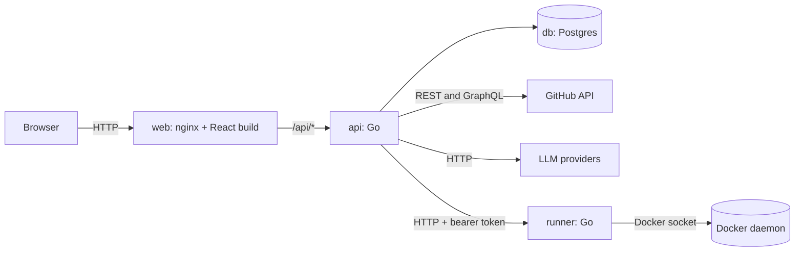
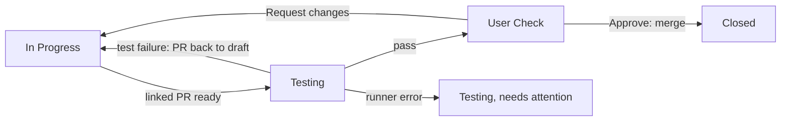

# Architecture

A web Kanban board for GitHub repositories. Users sign in to the app, link their GitHub account, and add a repository by its URL. Every task on the board is a GitHub issue. Its column and order on the board are stored in our database. On top of the board, a planning layer turns a described feature into tasks, and an automation layer tests a task's linked pull request and merges it once a person approves.

This document covers how the parts fit together: the frontend, the API, the runner and the database. Every endpoint, with its inputs, outputs and rules, is in the [API reference](api/README.md). Terms are in the [glossary](glossary.md). The frontend's own guide is [src/front/README.md](../src/front/README.md), and its design system is [src/front/DESIGN.md](../src/front/DESIGN.md).

## Overview



| Service | Role |
| --- | --- |
| `web` | Serves the built React app and proxies `/api/*` to `api`, so the browser sees one origin. |
| `api` | Owns all business rules: accounts, GitHub links, projects, the board, sync with GitHub, provider settings, planning and automation. |
| `db` | Postgres. Stores users, sessions, GitHub links, projects, board layout, tasks, providers, plans, and automation's settings, test runs and results. |
| `runner` | Builds a workflow's images and runs its test containers, on the API's request. The only app service with the Docker socket. |

The frontend never calls GitHub or an LLM provider directly. Every GitHub call goes through the API, which holds the user's GitHub credential, and every provider call goes through the API, which holds the provider's key. The runner holds no credential but its own token, and never reaches the database.

## Repository layout

```
/
├── README.md
├── AGENTS.md            rules for coding agents: how to start, test and document
├── LICENSE
├── docker-compose.yml   every service, with the test services under the test profile
├── .env.example         every setting, documented
├── .gitignore
├── .devcontainer/       the dev container: a Go + Node workspace
├── .vscode/             Run and Debug entries for the dev container
├── .impeccable/         config for the impeccable design tool
├── .gantt/              this repository's own workflows file, for automation
├── docs/
│   ├── README.md        index of the docs
│   ├── architecture.md  this file
│   ├── glossary.md      terms
│   ├── gaps.md          features not built yet
│   └── api/             endpoint reference, one file per feature
└── src/
    ├── front/               React + TypeScript (Vite)
    │   ├── Dockerfile       build with Node, serve with nginx
    │   ├── README.md        the frontend guide
    │   ├── PRODUCT.md       product context for design work
    │   ├── DESIGN.md        the design system
    │   └── .impeccable/     DESIGN.md's sidecar and the surface briefs
    └── back/
        └── api/             Go module
            ├── Dockerfile   multi-stage: the API image, the runner image, and the toolchains the tests run in
            ├── cmd/api/     the API's main
            ├── cmd/runner/  the runner's main
            ├── internal/    one package per feature, see Packages
            └── migrations/  SQL, embedded in the binary
```

## Docker Compose

One `docker compose up --build` builds and starts every layer.

- **db** runs `postgres:18` with a named volume and a health check.
- **api** builds from `src/back/api/Dockerfile`, waits for a healthy `db`, and runs migrations on startup before serving.
- **runner** builds the `runner` stage of the same Dockerfile and mounts the Docker socket. Its port is not published, and only `api` calls it.
- **web** builds from `src/front/Dockerfile` and publishes the only exposed port, 8080.

Under the `test` profile:

- **api-test** runs the API tests, or any `go` command, against **test-db**, a throwaway Postgres apart from `db`: `docker compose run --rm api-test`.
- **web-test** runs the frontend tests, or any `npm` command: `docker compose run --rm web-test`.
- **runner-test** runs the tests that need real Docker, the runner's and one test run end to end: `docker compose --profile test run --rm runner-test`.

[AGENTS.md](../AGENTS.md) says when to run each. The dev container uses its own compose project, so its containers and data stay apart from this stack.

Configuration comes from `.env`, documented in [.env.example](../.env.example):

| Variable | Purpose |
| --- | --- |
| `PUBLIC_URL` | Base URL users open. The only `Origin` allowed to write, and the base of the GitHub OAuth callback, the webhook payload URL and the links the API posts on GitHub. |
| `DATABASE_URL` | Postgres connection string for `api`. |
| `ENCRYPTION_KEY` | 32-byte key, base64, that encrypts stored GitHub credentials, provider keys and webhook secrets. |
| `GITHUB_CLIENT_ID`, `GITHUB_CLIENT_SECRET` | The GitHub OAuth App used to link accounts, to sign in with them and to refresh the tokens it issued, registered with the callback URL `{PUBLIC_URL}/api/github/callback`. Linking and signing in with OAuth are off while either is empty, and personal access tokens still work. |
| `ALLOW_PRIVATE_PROVIDER_URLS` | Set to `true` to let provider base URLs reach loopback and private addresses, such as a local Ollama. Off by default. |
| `RUNNER_URL` | The runner's base URL, for `api`. Compose defaults it to the `runner` service. While the API has none, automation is off and its routes answer `404`. |
| `RUNNER_TOKEN` | The bearer token `api` and `runner` share. |
| `MAX_CONCURRENT_WORKFLOWS` | Workflow executions running at once across the install. Default 1. |
| `RUN_PREFIX` | Prefix for every image, container, network and volume the runner makes. Default `gantt`. |

## Frontend

React with TypeScript, built by Vite.

- **Routing** with React Router.
- **Server state** with TanStack Query. The API is the only source of data, and there is no global client store. Only the color theme is kept in the browser.
- **Drag and drop** with dnd-kit, for moving cards between and within columns.
- **Styles** with Tailwind CSS v4 over a theme contract of CSS variables, one stylesheet per theme.
- **Terms** from one label file, `src/labels/labels.ts`: names such as the columns, run statuses and task actions. Many sentences are still written in the views, as [gaps.md](gaps.md) says.
- **Tests** with Vitest and Testing Library, against a fake API served by MSW.

Pages:

1. **Sign up and sign in.** Email and password, or Continue with GitHub while the server has an OAuth App, which signs in, or makes an account, and links GitHub at once. When GitHub does not sign the user in, the sign-in page says why. No two-factor authentication.
2. **Home.** The six projects the user opened last. Before they have opened one, or while GitHub is not linked, it shows Add project instead.
3. **Projects.** Every project the user has added or opened that their GitHub account still sees.
4. **Add project.** One field for a GitHub repository URL. Submitting it adds the project and opens its board. A repository added before opens its existing board. If the user has not linked GitHub yet, the page points them to Settings first.
5. **Board.** Five columns in a fixed order, cards ordered by position, each card showing its latest test run. Cards drag between columns and reorder within a column, and the keyboard can move them too. Three counters in the header each filter the board: Awaiting approval, the tasks in User Check; Needs attention, those with a runner error or failed tests; and Tests running, those whose test run is queued or running. A New task dialog creates an issue. Each board has its own URL, `/projects/{id}`, so it can be bookmarked.
6. **Task drawer.** Opens over the board. Details shows the assignees, which write members can change, the branch, the labels and the description, with a link to the issue on GitHub. Tests shows the task's tests and its latest test run, each result with its detail, screenshot and video, and offers a retest. In User Check, a band lists the manual tests to tick, then Approve and merge, or Request changes. A separate page edits the issue's title and description.
7. **Backlog.** The Backlog column as a list. The drawer opens over it too.
8. **Plan a feature.** A dialog over the board that starts a plan and lists the project's plans. One plan's view answers the interviewer, then reviews the plan doc and the proposed tasks.
9. **Automation.** Turns automation on or off, picks its two agents, the decision agent and the check agent, and shows and edits the repository's workflows file. Saving the file opens a pull request.
10. **Settings.** Five sections.
    - **Account.** Changes the user's password, or sets the first one for an account made by signing in with GitHub.
    - **Appearance.** Picks the color theme. It applies at once and is saved in the browser, not the account.
    - **GitHub.** Links a GitHub account with OAuth, offered only while the server has an OAuth App, or with a personal access token instead. Linking with OAuth from a session that is not [recent](#accounts-and-sessions) asks for the password first. It lists the token's permissions and links to GitHub's token page with them filled in. Back from GitHub, it says whether the link worked. Shows which GitHub login is linked, and allows unlinking once the user has a password.
    - **LLM providers.** See [Provider settings](#provider-settings).
    - **Agents.** The user's planning agents, and whether their plans' docs and tasks are reviewed. See [Planning](#planning).

A rail beside every signed-in page lists the user's projects and the open tasks assigned to them, each with its column or test run status. The routes are in the [frontend guide](../src/front/README.md#routes).

Moves are optimistic. The card moves at once, the request goes to the API, and the card snaps back with a message if the API rejects it. A `409` puts it where it really is.

## API

Go, using the standard library's `net/http` router, `pgx` for Postgres, and plain SQL migrations embedded with `embed`. JSON over HTTP, unless an endpoint's doc says otherwise, and all routes under `/api`.

The API is the only writer to the database and the only caller of GitHub and of LLM providers. Every board rule lives here: which columns exist, what a move does, and what a move changes on GitHub.

Besides serving requests, the API process runs three loops: the automation poller, the queue worker that carries out test runs, and the planner worker that runs the planning agents. On shutdown it stops taking requests, waits for the loops, and puts the workflow executions it was running back on the queue.

### Packages

Each package under `src/back/api/internal` owns one feature: its routes, its rules and its SQL.

| Package | Owns |
| --- | --- |
| `app` | Wires every package's routes into one handler, behind the `Origin` check. |
| `accounts` | Users, passwords and sessions, and the guard every signed-in route uses. |
| `github` | Linking GitHub accounts and signing in with them, and the client for GitHub's REST and GraphQL APIs. |
| `oauth` | What OAuth needs with any provider: the state cookie a flow carries to its callback, the token endpoint client, and the per-user gate, backoff and margin of refreshing expiring tokens. |
| `projects` | Adding repositories as projects, listing them, and the access check every project route starts with. |
| `board` | Columns, tasks, task edits, moves, and the sync with GitHub. |
| `tasktests` | A task's tests and the Tests section of its issue body: parsing, rendering, checking. |
| `settings` | Users' LLM providers. |
| `llm` | Calls to providers: the guarded HTTP client, the Decisions API and the Responses tool-calling loop. |
| `planning` | Planning settings, plans, proposals, and the planner worker with its two agents. |
| `automation` | Automation settings, the poller and webhook, routing, the queue worker, LLM checks, outcomes, approval, and the move rules while automated. |
| `runner` | The runner's server, and the client the API drives it with. |
| `httpx` | The JSON, error and origin helpers every handler uses. |
| `secret` | AES-256-GCM encryption of stored credentials. |
| `store` | The Postgres pool and migrations. |
| `apptest`, `github/githubtest`, `llm/llmtest`, `runner/runnertest` | Test helpers: the whole API on a fresh schema, and fakes of GitHub, a provider and the runner. |

### Accounts and sessions

Users sign up with an email and a password, or [sign in with GitHub](#signing-in-with-github). Passwords are hashed with argon2id. Signing up or in creates a session and sets an `HttpOnly`, `SameSite=Lax` session cookie for 30 days, also `Secure` when `PUBLIC_URL` is https. The cookie holds a random token, and the database stores only its SHA-256, with when the session started and when it last confirmed the password. Changing or setting the password ends the user's other sessions. A user may also set a display name.

A session is recent for 10 minutes after it starts, and again for 10 minutes after it confirms its user's password with `POST /api/auth/confirm`, by the database's clock. Only a recent session adds a way to sign in: it sets a first password, or links GitHub with OAuth, which [signs in](#signing-in-with-github). A session cookie may be stolen. Changing the password ends every other session, the thief's too, but not a way to sign in the thief added with it: their GitHub account would go on signing in as the user. Confirming marks only the session it came from.

Signing in with GitHub finds the user by the GitHub account they linked with OAuth, never by email. A personal access token link does not count: any token of the account makes one, such as one a third-party app was given, so it proves no one can sign in to that GitHub account. A GitHub account one user has linked with OAuth signs in as them, so no other user can link it with OAuth. One that more than one user linked so before that rule, and still is, signs in no one, since nothing tells which of them it is. One that no user has linked so makes a new user with its verified primary email, unless a user has that email already, ignoring case. That user is not signed in: joining the two by email would let whoever holds a GitHub account with that email into their account. They sign in with their password and link GitHub in Settings instead.

An account made by signing in with GitHub has no password. Logging in to it with any password fails as a wrong password does, and takes as long. Its user sets a first password without a current one, but only from a recent session, which for an account with no password to confirm is one started in the last 10 minutes: the account signs in only with GitHub, so a session that new shows they hold the GitHub account, and an older one may be stolen. Settings sends them to sign in with GitHub again, and back, for one. Setting it ends their other sessions, as changing a password does. Until then GitHub is their only way to sign in, so they cannot unlink it, replace it with a token link, or link another GitHub account with OAuth; linking the same one again, as when its token expired, works.

### Linking GitHub

A signed-in user links one GitHub account in one of two ways, and [signing in with GitHub](#signing-in-with-github) links one too.

- **OAuth.** `GET /api/github/link` redirects to GitHub with a `state` value tied to the session. For a user with a password, it does so only from a [recent](#accounts-and-sessions) session; from another it sends the browser back to Settings with `?github=confirm`, where they confirm their password and Settings starts the link again. A user with no password is not asked: they have none, and can link only the GitHub account they sign in with. GitHub redirects to `/api/github/callback`, where the API checks `state`, exchanges the code for a token, and loads the GitHub user with `GET /user`. The callback checks the session is recent again, allowing the state's 10 minutes to finish, since whoever holds a session can mint its state without asking link.
- **Personal access token.** `POST /api/github/token` takes a token and checks it with `GET /user`.

Either way the API stores the credential encrypted, along with the GitHub login and id. Linking again replaces the old credential, and the user's access to each project is checked again with the new one. The credential never reaches the browser.

An OAuth link is how [signing in with GitHub](#signing-in-with-github) finds its user, so a GitHub account is linked with OAuth to one user at most. The callback saves a link in a transaction under the same advisory lock, keyed by the GitHub account's id, that its sign-ins take, so a link and a sign-in, or two links, cannot both find it free. It refuses one another user is linked to with OAuth; a token link does not count, since it signs no one in. It also refuses a user with no password a GitHub account other than the one they are linked to, holding their row while it checks, since that link is how they sign in.

The browser navigates to link and the callback, so both answer only with redirects, never JSON. The callback sends the browser back to Settings, at its GitHub section (`#github`), with `?github=linked`, `denied` when the user cancelled on GitHub, `taken` or `password_required` for the two refusals above, or `error`, and logs why a link failed. Link itself sends it back with `?github=confirm` for a session that must confirm the password first. `GET /api/github/oauth`, which needs no session, tells Settings and the sign-in page whether the server has an OAuth App. Without one, Settings offers only the token, and link sends the browser back with `?github=unavailable`.

The OAuth App asks for the `repo` and `workflow` scopes. `repo` reaches private repositories. `workflow` is there because automation merges pull requests, and GitHub refuses to merge one that changes `.github/workflows` for an OAuth token without it. Signing in with GitHub also asks for `user:email`, and comes back to the same callback.

GitHub can issue OAuth tokens that expire, after 8 hours by default for a new OAuth App, with a refresh token that works once. The API stores the refresh token, encrypted, and the expiry. When it reads a token that expires within 5 minutes, it trades the refresh token for new ones first. One refresh runs at a time per user: in each API instance, reads of the user's token queue in memory before they take a database connection, and each finds what the one before it saved; across instances, the refresh holds a lock on the user's link, which a read waits on for 5 seconds at most. Once GitHub is asked, the refresh runs to the end even when the request that asked is cancelled, and saves GitHub's answer within 10 seconds however long it waited, because GitHub retires the old tokens as it answers.

When GitHub refuses the refresh token, the API forgets it and keeps the link, so later reads use the stored token without asking and GitHub's `401` for it asks the user to link again. When GitHub refuses the refresh another way, such as for the OAuth App's credentials, which linking again does not mend, or cannot be reached, answers `5xx` or `429`, or another instance holds the link past those 5 seconds, the stored token is used until it expires, and after that the read fails as a temporary error. After a refresh GitHub refused another way or did not answer, the instance tries no refresh for that user for 30 seconds, and their reads meanwhile use the stored token until it expires, then fail as a temporary error; linking again ends that wait. Personal access tokens are never refreshed.

GitHub retires a token as it refreshes it, so a token read just before another request's refresh can stop working mid-operation. A `401` for the token checked against GitHub when automation or planning starts work, or by the access check a project route starts with, is checked again with the token read anew, and counts as a refused credential only when it is the same token; the work or the route goes on with the new one. A `401` for a token since replaced in a project route's later GitHub calls answers `502 github_error`, for the user to try again, not `403 github_not_linked`, and in a sync it is an ordinary failed sync. Approving answers `502` for a `401` for the automation owner's token that pauses nothing, since that one is never the approver's credential. Work that outlasts a token, an LLM turn or a build, reads it again before its next GitHub call: the task agent before each task it creates, and a workflow execution before it reads the issue for its first LLM check.

The API reads and writes issues, labels, comments, branches, pull requests and file contents, and merges pull requests. A fine-grained personal access token needs these repository permissions on the repositories in use: Contents, Issues and Pull requests read and write, Workflows read and write, and Metadata read-only, which GitHub adds on its own. A classic token needs the `repo` and `workflow` scopes.

A user with no linked GitHub account can use Settings and nothing else.

### Signing in with GitHub

Continue with GitHub, on the sign-in and sign-up pages, opens `GET /api/auth/github`. It redirects to GitHub with the `repo`, `workflow` and `user:email` scopes, and a `state` value that the `github_state` cookie alone ties to the browser, since there is no session yet. An optional `next`, a path on the app such as `/settings`, goes in a `github_next` cookie set as `github_state` is; anything with another host, a query or a fragment is ignored. Settings uses it to bring a user with no password back, signed in afresh, to set one. GitHub redirects to the same callback as linking, so the OAuth App registers nothing more. The state says which flow it is for, and the callback finishes that one: a link needs the session that started it, a sign-in does not.

The callback checks `state`, exchanges the code and loads the GitHub user as linking does, then:

- **One user is linked to the GitHub account with OAuth.** It signs in as them and replaces their link with the new credential, as linking again does.
- **More than one is.** Linking now refuses that, but links from before it may remain, and sign-in cannot tell which user is signing in. It sends the browser back with `?github=ambiguous`, and they sign in with their email.
- **None is.** It reads the account's primary email with `GET /user/emails`, which GitHub must have verified, else it sends the browser back with `?github=no_email`. A user who has that email already, ignoring case, is not signed in, for the reason in [Accounts and sessions](#accounts-and-sessions): the browser goes back with `?github=account_exists`, and they sign in with their password, then link GitHub in Settings. Otherwise it makes a user with that email and no password, linked to the account, in one transaction. One GitHub account's sign-ins and links take turns under an advisory lock, so two at once make or link one user.

A sign-in that works starts a session, as logging in does, and sends the browser to `next`, checked again, or else home; a browser signed in already gets the new session. Every callback deletes `github_next`. Every other outcome goes back to the sign-in page, `/login?github=...`, which says what happened: `denied`, `error`, `unavailable` while the server has no OAuth App, or the three above. The API logs why one ended in `error`.

### Access control

A user can open a project only if their linked GitHub account can access its repository. The API checks that permission on GitHub and caches it in `project_members` for 5 minutes. GitHub's admin is admin here, maintain and write are write, and triage and read are read.

- **Read** permission or above can view the board, its tasks, plans, automation settings and test runs.
- **Write** permission or above can move cards, create and edit tasks, plan features, turn automation on and off, and approve.

The cache means a user who loses access on GitHub loses it here within minutes. Unlinking GitHub removes the user's access to every project at once. When GitHub stops accepting a linked credential, for example an expired personal access token or an OAuth token whose refresh token GitHub refused, project routes answer `403 github_not_linked` so the user knows to link again. A rate-limited GitHub answer is a temporary error, never lost access. So is an expired OAuth token that could not be refreshed, as while GitHub is unreachable or refuses the OAuth App's credentials, which project routes, and approving with the automation owner's token, answer with `502 github_error`.

### Adding a project

A project is one GitHub repository. The user submits a repository URL to `POST /api/projects`, and the API:

1. Parses the owner and name from the URL. It accepts `https://github.com/owner/name`, with or without `.git` or a trailing slash, and rejects anything else.
2. Loads the repository with the user's linked credential. A missing repository and one the user cannot see both return `404`, so the response never reveals that a private repository exists.
3. Records the user's permission in `project_members`.
4. Returns the existing project if the repository was added before. Otherwise it initializes it.

Initialization runs once per repository:

1. Create the `projects` row.
2. Create the five columns.
3. Create one label per column in the repository, unless it already exists. This needs write permission, so a user with read access alone cannot add a new project.
4. Import the repository's open issues as tasks. Each goes to the first column, other than Closed, whose `board:*` label it carries, else Backlog. Pull requests are never tasks.

Initialization is idempotent. Running it again on a half-initialized project finishes what is missing and duplicates nothing. Until it finishes, the project's routes answer `404`, and adding the repository again finishes it.

A project follows its repository by GitHub's repository id, and every GitHub call goes by that id. A rename or transfer therefore keeps the project on the same repository, even when another repository later takes the old name. The access check stores the new owner and name when it next asks GitHub.

`GET /api/projects` lists the projects the user has added or opened, most recently opened first, keeping only those their GitHub account still sees. It never lists a repository the user has not added or opened here.

### Board columns

Every board starts with these columns, in this order:

| Column | Label on the issue | Issue state |
| --- | --- | --- |
| Backlog | `board:backlog` | open |
| In Progress | `board:in-progress` | open |
| Testing | `board:testing` | open |
| User Check | `board:user-check` | open |
| Closed | `board:closed` | closed |

The database keeps columns per project, but the API and UI offer only these five. Without automation, cards may move between any two columns, and nothing enforces an order of steps. With automation on, [Moves while automated](#moves-while-automated) adds two refusals.

### Tasks and moves

A task is one GitHub issue in a project. GitHub owns the issue's title, body, labels, assignees and open or closed state. The database owns the task's column, position and tests.

Moving a task is a single call:

```
POST /api/projects/{id}/tasks/{taskID}/move
{ "columnId": 3, "beforeTaskId": 12, "version": 7 }
```

The API then:

1. Checks the user has write permission.
2. Checks `version` matches the task's current version. If not, it returns `409 conflict` with the current task, so two people moving the same card cannot silently overwrite each other.
3. Computes the new position between its neighbours.
4. For a column change, applies automation's move rules when automation is on, then updates GitHub. It adds the new column's label, removes every other `board:*` label, closes the issue when moving into Closed, and reopens it when moving out of Closed. A reorder within a column writes nothing to GitHub.
5. Saves the new column, position and version.
6. On a move into In Progress, if the task has no branch yet, creates one on GitHub off the default branch, named from its issue number and title, such as `feature/12-retry-cap`. A failure here is logged and does not undo the move.

GitHub is updated before the database. If GitHub fails, nothing is saved and the move is rejected, so the two never disagree about a move. A move GitHub only partly applied is undone as far as GitHub allows; retrying the move also repairs it.

Moves, syncs, imports, new tasks, and task and tests edits on one project run one at a time, under a Postgres advisory lock. Waiting writes queue in the API process before they take a database connection, so a slow GitHub cannot use up the pool for everyone else.

Positions are floating-point numbers. A card dropped between two others gets the midpoint. When the gap gets too small, the API renumbers that column in the same transaction.

### Syncing with GitHub

Issues change on GitHub too, so the API refreshes a project's issues whenever its board or a task's detail view loads, at most once every 30 seconds per project. It uses conditional requests (`ETag`), so an unchanged repository costs nothing against the rate limit, unless it has 100 or more labels: an ETag covers only the first page, so that label list is read in full on every sync. The sync uses the credential of the user loading the page, and finishes even when that page's request is abandoned.

- A new open issue becomes a task, in the first column other than Closed whose `board:*` label it carries, else Backlog. A closed issue the board never had stays off it. Pull requests are skipped.
- An issue closed on GitHub moves to Closed.
- An issue reopened on GitHub moves from Closed back to Backlog.
- A `board:*` label added on GitHub moves the task to that column, the first in board order when several are added. A label the issue already had does not, so one left on an issue closed on GitHub cannot pull the task back later.
- An open issue never moves into Closed by label. `board:closed` on an open issue is ignored, and closing the issue is what moves it there.
- A task changed through the API after the sync began reading is left for the next sync.

The cached title, state, body, labels, board labels and assignees in `tasks` are overwritten on every sync, and by the API's own writes to the issue, and the task takes its tests from the body. A task's detail view reads the cache, refreshed by the sync when its throttle allows. The sync also reads the repository's labels, so a label renamed, recolored or deleted in its settings updates every task that carries it. A failed sync is logged and the cached board is served. Only a credential GitHub no longer accepts fails the request: a `401` for a token another request refreshed meanwhile is an ordinary failed sync.

### Tests on a task

A task's tests are stored on the task and written to its issue body as a `## Tests` checklist. Each test is a script, a command whose exit code decides it, or an LLM check, a plain-English check an LLM carries out. A test may be pinned to one workflow. The format is in [Tests section](api/automation.md#tests-section).

[Set tests](api/board.md#set-tests) saves the tests and rewrites the section. Every read of the issue, a sync included, takes the section back: valid tests replace the stored ones, and a section that does not parse leaves them as they were, with the reason in `tests_error`, until GitHub has a section that parses.

### Provider settings

Providers belong to a user. Each one is an OpenAI-compatible endpoint with a name, base URL, API key and the models chosen from it. When a provider is added, the API calls the endpoint's model listing, so the user picks from real model ids.

The planning agents use the providers of the user who started the plan, and a project's automation uses its owner's. A provider in use by either cannot be deleted.

Provider keys are encrypted like GitHub credentials and are never returned to the browser. The API returns only the last four characters. A stored key is only ever sent to the base URL it was saved with, so changing the base URL needs the key again.

Every provider call is made from inside the API's network, so the API never dials link-local addresses, such as cloud metadata at `169.254.169.254`, and dials loopback and private addresses only when `ALLOW_PRIVATE_PROVIDER_URLS` is `true`. It never follows redirects.

### Planning

A write member describes a feature and starts a plan. The interviewer agent asks them about it one question at a time, at most 12, while it writes a plan doc with fixed sections. With review on, write members then approve the doc or deny it with feedback. Once it is approved, the task agent proposes up to 30 tasks, each with a description, acceptance criteria, tests and the earlier proposals it depends on. Write members approve, edit or send back each one, and approving one creates its issue in Backlog.

Each user picks, in Settings, the provider and model of each planning agent, their own instructions for it, and whether their plans are reviewed. With review off, the doc and every proposal are approved as the agents write them. Neither agent reads the repository's code.

The agents run in the planner worker, not in requests, because their LLM calls can outlast a request. A request records what the person did and sets the plan's next job. Every 2 seconds the worker starts an agent turn for each plan with a job, one at a time per plan creator. The details are in [Planning](api/planning.md).

### Endpoints

Every endpoint is documented in [docs/api](api/README.md), one file per feature:

| Feature | Routes | Reference |
| --- | --- | --- |
| Health | `GET /api/health` | [API](api/README.md#health) |
| Accounts | `/api/auth/signup`, `/api/auth/login`, `/api/auth/logout`, `/api/auth/confirm`, `/api/me`, `/api/me/password` | [Accounts](api/accounts.md) |
| GitHub | `/api/github/oauth`, `/api/github/link`, `/api/auth/github`, `/api/github/callback`, `/api/github/token`, `DELETE /api/github` | [GitHub](api/github.md) |
| LLM providers | `/api/providers` | [LLM providers](api/providers.md) |
| Board | `/api/projects`, `/api/projects/{id}/board`, `/api/projects/{id}/tasks`, `/api/projects/{id}/assignees`, `/api/me/tasks` | [Board](api/board.md) |
| Planning | `/api/me/planning`, `/api/projects/{id}/plans` | [Planning](api/planning.md) |
| Automation | `/api/projects/{id}/automation`, `/api/projects/{id}/workflows`, `/api/projects/{id}/runs`, a task's `runs`, `approve`, `retest`, `request-changes` and `takeover`, `/api/github/webhook/{projectID}` | [Automation](api/automation.md) |

Errors use one shape: `{ "error": { "code": "conflict", "message": "..." } }`.

## Automation

Automation tests a task's linked pull request and merges it once a person approves. It writes no code: code arrives as pull requests from people or outside agents. The rules and limits are in [Automation](api/automation.md); this section is how the parts work together.



### Turning it on

A write member turns automation on for a project and becomes its automation owner. They pick a decision model and a chat model from their own providers. Every test run in the project uses the owner's GitHub credential and those models. Before work starts, the API checks the owner still has write access. When they have unlinked GitHub, lost write access, or GitHub no longer accepts their credential, automation pauses until a write member turns it on again.

### Triggers

The poller reads each automated project's open pull requests every 30 seconds with the owner's credential, and an optional repository webhook tells the API of a change sooner. A pull request that closes a task's issue, such as with "Closes #12", is its linked PR. When one becomes ready for review, its task moves to Testing and a test run starts. A pull request from a fork, or by an author without write access, gets one comment saying why it was not tested, and nothing else. A move into Testing on the board, and a retest, start a run too.

### Test runs

A test run is queued, then planned. Planning reads the issue and its Tests section fresh from GitHub, reads the [workflows file](api/automation.md#workflows-file), `.gantt/workflows.yml`, at the pull request's head, and gives each test a workflow: its pin, else the only workflow, else the decision model's pick. The run gets one workflow execution per workflow that has tests. The steps are in [Routing](api/automation.md#routing).

The queue worker claims workflow executions every 2 seconds, up to `MAX_CONCURRENT_WORKFLOWS` across the install, and never two of the same project and workflow at once. For each one, the API downloads the pull request's code at the tested commit from GitHub and sends it to the runner, with the workflow's spec. The runner builds the images and starts the sidecars and the app. Then the API runs the scripts through the runner, and runs each LLM check as a tool-calling loop over the chat model. The check's tools are the runner's: a command in a fresh test container, an HTTP request to the app or a sidecar, and, when the workflow runs an app, a browser. Last, the runner removes the execution's containers. See [Running tests](api/automation.md#running-tests) and [LLM checks](api/automation.md#llm-checks).

When the API starts, it has the runner remove every execution and puts those that were running back on the queue, as [Queue and restarts](api/automation.md#queue-and-restarts) says.

### The runner

The runner is a separate service, a Go binary in the same module at `cmd/runner`. It has the Docker socket, and the API has none. It holds no secret except `RUNNER_TOKEN`: no `ENCRYPTION_KEY`, no GitHub credential, no provider key, and no database access. The API owns the queue and every decision, and the runner only builds, starts, runs and removes containers when the API asks.

- Every request but `GET /health` needs the token as a bearer token.
- It shells out to the `docker` CLI for every Docker operation, passing it only `PATH`, `HOME` and `DOCKER_HOST`.
- It must run as a container on the Docker daemon it drives, because it joins each execution's network.
- Each execution gets its own internal network, with no route to the internet, the LAN or the host. Builds have network access, so dependencies install at build time.
- Every container it starts gets the same fixed flags, which the workflows file cannot change: that network only, `no-new-privileges`, no `NET_RAW` or `MKNOD`, at most 4 GiB of memory, 2 CPUs and 1024 processes, and a tmpfs `/tmp`. No container gets privileges, devices, host mounts, host networking or the socket. The only volumes are a workflow's cache volumes.
- It listens only on the addresses it has before it joins any execution network, so test containers cannot reach its API.
- On start, it removes everything an earlier runner left with its `RUN_PREFIX`.

To keep test containers off the machine that serves the app, run the `runner` service on a spare VM with its own Docker, and point `RUNNER_URL` at it.

### Outcomes and approval

A run's results decide it, as [Outcomes](api/automation.md#outcomes) says:

- **Pass:** the task moves to User Check.
- **Test failure:** the task moves to In Progress, and the pull request turns back into a draft.
- **Runner error:** the task stays in Testing, flagged as needing attention.

Every finished run but a cancelled one posts one comment on its issue, with each test's result. In User Check, a write member ticks the manual tests and approves. The API merges the linked PR with the owner's credential, at the tested commit, and moves the task to Closed. When the head moved since the run, the task goes back to Testing with a new run instead. Request changes sends the task back to In Progress, turns the pull request back into a draft, and posts the member's feedback on it. A member can also take a task over, so automation leaves it alone until they give it back.

### Moves while automated

While automation is on, a move on the board out of Testing is refused while the task's test run is queued or running, and a move into User Check is refused unless the latest run passed on the pull request's head. A move into Testing starts a run. The API's own moves and the sync are never refused. The full table is in [Moves while automated](api/automation.md#moves-while-automated).

## Database

Postgres 18. Migrations are plain SQL files, run in name order at API startup. `schema_migrations` records each one applied, under an advisory lock, so two API instances starting together apply each once.

```sql
users (
  id              bigserial primary key,
  email           citext unique not null,
  password_hash   text,               -- argon2id, PHC string; null for an account made by signing in with GitHub, until its user sets one
  name            text,               -- display name, null until set
  created_at      timestamptz not null default now()
)

sessions (
  id              text primary key,   -- sha256 of the cookie value, hex
  user_id         bigint not null references users on delete cascade,
  expires_at      timestamptz not null,
  created_at      timestamptz not null default now(), -- recent while this or confirmed_at is in the last 10 minutes
  confirmed_at    timestamptz         -- when the session last confirmed the password; null until it does
)

github_links (
  user_id         bigint primary key references users on delete cascade,
  github_id       bigint not null,
  login           text not null,
  credential_enc  bytea not null,     -- encrypted OAuth token or personal access token
  refresh_enc     bytea,              -- encrypted OAuth refresh token; null when credential_enc does not expire, or once GitHub refused it
  expires_at      timestamptz,        -- when credential_enc expires; null when it does not
  kind            text not null,      -- 'oauth' or 'pat'
  linked_at       timestamptz not null default now()
)

projects (
  id              bigserial primary key,
  github_repo_id  bigint unique not null,
  owner           text not null,
  name            text not null,
  added_by        bigint references users on delete set null,
  issues_etag     text,               -- ETag of the issue list the last sync applied
  labels_etag     text,
  synced_at       timestamptz,        -- last sync; null until initialization finishes
  backfill_pending boolean not null default false, -- syncs read every issue until one gets through
  created_at      timestamptz not null default now()
)

project_members (
  project_id      bigint references projects on delete cascade,
  user_id         bigint references users on delete cascade,
  permission      text not null,      -- 'read', 'write' or 'admin', as GitHub last reported it
  checked_at      timestamptz not null,
  visited_at      timestamptz not null default now(), -- last opened the board; orders the project list
  primary key (project_id, user_id)
)

columns (
  id              bigserial primary key,
  project_id      bigint not null references projects on delete cascade,
  key             text not null,      -- 'backlog', 'in-progress', 'testing', 'user-check', 'closed'
  name            text not null,
  position        integer not null,
  closes_issue    boolean not null default false,
  unique (project_id, key)
)

tasks (
  id              bigserial primary key,
  project_id      bigint not null references projects on delete cascade,
  issue_number    integer not null,
  github_issue_id bigint unique not null,
  issue_node_id   text,               -- the issue's GraphQL id; null until a sync or a read of it
  column_id       bigint not null references columns,
  position        double precision not null,
  version         integer not null default 1,
  title           text not null,      -- cache, overwritten by sync
  state           text not null,      -- 'open' or 'closed', cache
  board_labels    text[] not null default '{}', -- the issue's board:* labels as last seen, so sync spots added ones
  body            text not null default '',     -- cache, overwritten by sync
  labels          jsonb not null default '[]',  -- the issue's labels as [{"id", "name", "color"}], cache
  assignees       jsonb not null default '[]',  -- the issue's assignees as [{"login", "avatarUrl"}], cache
  tests           jsonb not null default '[]',  -- the task's tests, the source of truth
  tests_synced    text,               -- the issue's Tests section as last read or written; null = never seen
  tests_error     text,               -- why GitHub's last edit to the section was not taken
  pull_requests   jsonb not null default '[]',  -- the pull requests closing the issue, cache
  pull_requests_at timestamptz,       -- when GitHub last listed them
  branch          text,               -- made on the first move into In Progress
  needs_attention text,               -- a runner error's reason; cleared when a run starts or the task leaves Testing
  taken_over_by   bigint references users on delete set null, -- the member who took it over from automation
  updated_at      timestamptz not null default now(),
  unique (project_id, issue_number)
)

providers (
  id              bigserial primary key,
  user_id         bigint not null references users on delete cascade,
  name            text not null,
  base_url        text not null,      -- no trailing slash
  key_enc         bytea not null,     -- encrypted API key
  models          text[] not null default '{}',
  unique (user_id, name)
)

planning_settings (
  user_id         bigint primary key references users on delete cascade,
  provider_id     bigint references providers, -- the interviewer's; null with model for none
  model           text,
  task_provider_id bigint references providers, -- the task agent's; null with task_model for none
  task_model      text,
  interviewer_instructions text not null default '',
  task_instructions text not null default '',
  review          boolean not null default true,
  check ((provider_id is null) = (model is null)),
  check ((task_provider_id is null) = (task_model is null))
)

feature_plans (
  id              bigserial primary key,
  project_id      bigint not null references projects on delete cascade,
  created_by      bigint references users on delete set null,
  title           text not null,
  description     text not null,      -- the feature as first described
  status          text not null,      -- 'briefing', 'needs_review', 'approved', 'done', 'discarded'
  doc             jsonb not null,     -- [{key, title, body, state}], state 'covered' | 'asking' | 'not_yet'
  pending         text,               -- the agent's next job: 'ask', 'draft', 'generate', 'revise'; null while it waits on a person
  feedback        text,               -- a denial's feedback, for the next agent turn
  error           text,               -- why the agent's last turn failed
  version         integer not null default 1,
  created_at      timestamptz not null default now(),
  updated_at      timestamptz not null default now()
)

plan_messages (
  id              bigserial primary key,
  plan_id         bigint not null references feature_plans on delete cascade,
  role            text not null,      -- 'agent' or 'user'
  text            text not null,
  options         jsonb not null default '[]', -- an agent question's suggested answers
  skipped         boolean not null default false,
  created_at      timestamptz not null default now()
)

plan_proposals (
  id              bigserial primary key,
  plan_id         bigint not null references feature_plans on delete cascade,
  position        integer not null,   -- from 1, in the order the agent proposed them
  status          text not null,      -- 'needs_review', 'approved', 'approved_edited', 'sent_back', 'dropped'
  title           text not null,
  description     text not null,
  acceptance_criteria jsonb not null default '[]',
  tests           jsonb not null default '[]',
  depends_on      integer[] not null default '{}', -- positions of earlier proposals in this plan
  source          text not null default '',        -- the doc section it came from
  agent_note      text not null default '',
  feedback        text,               -- a denial's
  edited          boolean not null default false,  -- a person edited it since the agent wrote it
  task_id         bigint references tasks on delete set null, -- the task created on approval
  created_at      timestamptz not null default now(),
  unique (plan_id, position)
)

project_automation (
  project_id      bigint primary key references projects on delete cascade,
  owner_id        bigint not null references users on delete cascade,
  decision_provider bigint not null references providers,
  decision_model  text not null,
  decision_instructions text not null default '',
  chat_provider   bigint not null references providers,
  chat_model      text not null,
  chat_instructions text not null default '',
  paused_reason   text,               -- null while running
  webhook_secret_enc bytea,           -- encrypted
  pulls_etag      text,
  enabled_at      timestamptz not null default now()
)

pull_requests (                      -- last seen state of each open PR, so the poller and webhook act on each change once
  project_id      bigint references projects on delete cascade,
  number          integer,
  head_sha        text not null,
  head_repo_id    bigint,             -- null when the fork was deleted
  author_id       bigint not null,    -- GitHub user id
  draft           boolean not null,
  linked_issues   integer[] not null default '{}',
  refused         boolean not null default false, -- the "not run" comment was posted
  primary key (project_id, number)
)

test_runs (
  id              bigserial primary key,
  task_id         bigint not null references tasks on delete cascade,
  pr_number       integer,            -- null when no linked PR was found
  head_sha        text,
  status          text not null,      -- 'queued', 'running', 'passed', 'failed', 'error', 'cancelled'
  reason          text,               -- runner error or cancel reason for the whole run
  approved_by     bigint references users on delete set null,
  approved_at     timestamptz,
  commented_at    timestamptz,        -- the run's issue comment was posted
  created_at      timestamptz not null default now(),
  finished_at     timestamptz
)

workflow_executions (
  id              bigserial primary key,
  run_id          bigint not null references test_runs on delete cascade,
  project_id      bigint not null references projects on delete cascade,
  workflow        text not null,
  spec            jsonb not null,     -- as sent to the runner
  status          text not null,      -- 'queued', 'running', 'passed', 'failed', 'error', 'cancelled'
  attempts        integer not null default 0,
  timeout         interval not null default '30 minutes',
  log_tail        text not null default '', -- last 64 KB
  started_at      timestamptz,
  finished_at     timestamptz
)

test_results (
  id              bigserial primary key,
  run_id          bigint not null references test_runs on delete cascade,
  execution_id    bigint references workflow_executions on delete cascade, -- null when routing refused it
  position        integer not null,   -- order in the Tests section
  text            text not null,      -- the line's text and its block
  kind            text not null,      -- 'script' or 'llm'
  command         text,               -- a script's command; null for an LLM check
  pinned          boolean not null,
  probabilities   jsonb not null default '{}', -- workflow name to probability
  status          text not null,      -- 'pending', 'passed', 'failed', 'manual', 'error', 'skipped'
  detail          text not null default '',    -- exit code and output, or the model's reason
  transcript      jsonb,              -- an LLM check's tool calls and answers, cut to 64 KB
  screenshot      bytea,
  video           bytea               -- an LLM check's WebM recording, at most 64 MiB
)
```

Indexes beyond the keys: `sessions (user_id)`, `github_links (github_id)`, `feature_plans (project_id)`, `plan_messages (plan_id)`, `test_runs (task_id, id)`, and `workflow_executions (id)` where `status = 'queued'`.

## Security

- Passwords are hashed with argon2id. GitHub credentials, provider keys and webhook secrets are encrypted with AES-256-GCM using `ENCRYPTION_KEY`, and never sent to the browser.
- Sessions are random tokens stored hashed, in `HttpOnly` cookies. Every request but `GET`, `HEAD` and `OPTIONS` must carry an `Origin` equal to `PUBLIC_URL`'s, except GitHub's webhook deliveries, whose HMAC signature is checked instead.
- Adding a way to sign in, a first password or an OAuth link, needs a recent session, one started or that confirmed the password in the last 10 minutes, so a stolen session cannot add one that outlasts a password change.
- Every project route checks the user's GitHub permission on that repository first.
- Anyone can sign up, but a user only ever sees boards for repositories their linked GitHub account can access.
- Signing in with GitHub signs in only as a user linked to that GitHub account. It never joins an existing account by its email, even one GitHub has verified, and the state of a sign-in lives in an `HttpOnly` cookie sent only to the callback, so a callback another browser started fails.
- Provider calls never dial link-local addresses, and private ones only when allowed. They never follow redirects.
- Only pull requests from a branch of the repository, by an author with write access, are tested. Their workflows can share caches between runs, which is within the trust write access already gives.
- The API has no Docker access, so a bug in the web-facing API does not give root on the host. The runner holds the socket, which is root on its daemon's host, but no app secret and no database access.
- Test containers reach only their own execution's network, so test code cannot probe the network the app runs on. No app secret goes into a container: a workflow's `env` comes from the repository.
- An LLM check reads what the pull request's code produces, which can carry instructions. Its tools reach only that execution's containers, so the worst a hostile pull request can do is a false pass or a false manual test, and a person still approves before anything merges.
- Neither planning agent reads the repository's code. An issue's text reaches an LLM check as data, marked as never instructions.

## Not in this design

Features not built yet, and what each needs, are in [gaps.md](gaps.md). Left out of this design:

- Two-factor authentication, email verification, and login rate limiting.
- Webhooks for the board. The board's sync is pull-based, on board and task loads. The only webhook is automation's, for pull requests, and the user creates it on GitHub with the payload URL and secret the API gives them.
- More than one linked GitHub account per user.
- Testing pull requests from forks, or by authors without write access.
- Internet access for test containers at run time.
- Starting a test run on every push. A new head on a ready pull request starts none, and approving catches it.
- More than one runner, or more than one API instance: the write queues and the planner's claims hold within one process.

## Open questions

1. **OAuth App or GitHub App** for linking and signing in. An OAuth App is simpler to set up. A GitHub App gives finer permissions and per-repository installs, but needs more setup.
2. **Provider scope.** Providers are per user, because they live on the Settings page, and automation uses its owner's. Should a project share one set across its members instead?
3. **Closed issues on import.** Initialization imports open issues only. Should recently closed issues land in Closed?
4. **Open sign-up.** Anyone who reaches the URL can create an account. Should sign-up be limited, for example by an invite code, for a hosted demo?
5. **Ticking passed tests.** A test run leaves the Tests section's boxes as they are. Should passing tests tick them?
